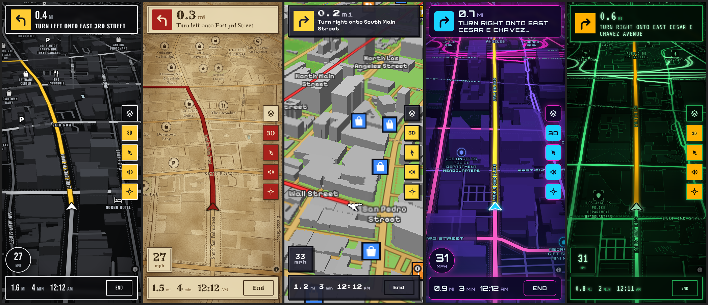
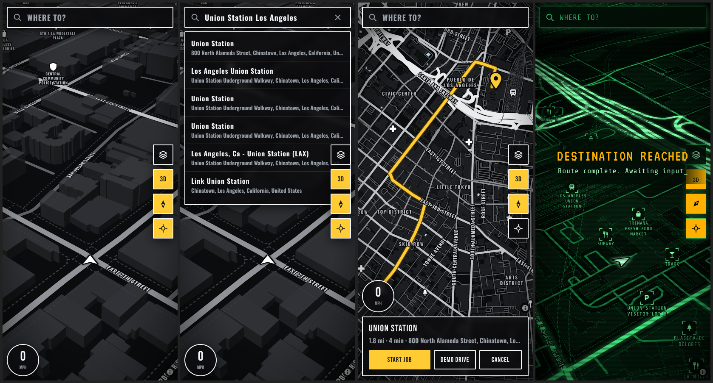

# GM Map

Real-world driving navigation drawn like a video-game map. Live GPS, search, turn-by-turn
directions and five switchable map skins, packaged as an Android app.





## Install on Android

Every push builds an installable APK with GitHub Actions.

1. Open the repo's **Actions** tab and pick the newest green **Android APK** run.
2. Under **Artifacts**, download `gm-map-apk` (a zip) and extract `gm-map.apk`.
3. Open the APK on your phone and allow "install unknown apps" when Android asks.
4. Allow location when the app opens. GPS starts on its own from then on.

## What it does

- **Five themes**, switchable at any time, even mid-route:
  **Heist** (blacked-out city radar), **Frontier** (hand-inked parchment),
  **Blockworld** (chunky pixel overworld), **Neon** (synthwave night grid) and
  **Terminal** (green-phosphor wireframe). Each has its own map colours, label font,
  place icons, player arrow and HUD.
- **Always-on GPS** with a heading-up, tilted 3D follow camera that zooms out as you speed up.
- **Search** for a place, or **long-press the map** to drop a waypoint.
- **Turn-by-turn navigation**: next-turn banner, distance and ETA, spoken directions,
  automatic re-routing when you leave the route, and an arrival banner.
- **Demo drive** to try a route without moving.
- **Speedometer** (tap it to switch mph / km/h), 2D/3D toggle, north-up/heading-up toggle.
- On Android: the screen stays on, and leaving the app mid-route shrinks it to a floating
  **picture-in-picture mini-map**.

## How it is built

The interface is a plain web app (no build step) at the repo root. The Android app in
`android/` bundles those same files and shows them in a WebView, adding what a web page
can't do well: the location permission, text-to-speech, keeping the screen on, system-bar
insets and picture-in-picture.

| Path | What lives there |
| --- | --- |
| `index.html`, `styles.css` | Page and HUD styling |
| `src/themes.js` | Theme definitions: palettes, fonts, HUD colours, wording |
| `src/mapstyle.js` | Turns a theme into a MapLibre map style |
| `src/icons.js` | Place icons, drawn at runtime in each theme's style |
| `src/main.js` | Map, player marker, follow camera, navigation state |
| `src/nav.js`, `src/routing.js` | Turn-by-turn logic and the routing client |
| `src/location.js`, `src/search.js` | GPS / demo-drive sources and place search |
| `src/platform.js` | Bridge between the web UI and the Android shell |
| `android/` | Kotlin shell (`MainActivity.kt`) and Gradle build |
| `vendor/` | MapLibre GL JS and the theme fonts |

Adding a theme is one new entry in `src/themes.js`.

### Run it in a browser

```sh
npm start        # http://localhost:5173
npm test         # unit tests for the geometry and navigation logic
```

Handy URL options: `?theme=neon`, `?lat=34.04&lng=-118.25&z=15`, `?units=metric`.

### Build the APK yourself

```sh
cd android
./gradlew assembleDebug     # needs JDK 17+ and the Android SDK
```

The APK lands in `android/app/build/outputs/apk/debug/`. Builds are signed with the debug key
in `android/debug.keystore` so each build installs over the last. It is not a release key:
publishing to an app store needs your own private key and your own `applicationId`.

## Map data and services

No API keys are needed. The app uses free public services, all built on OpenStreetMap:

- Map tiles and fallback label fonts: [OpenFreeMap](https://openfreemap.org)
- Driving routes: OpenStreetMap Germany's OSRM server, then the OSRM demo server as a backup
- Place search: [Photon](https://photon.komoot.io), then Nominatim as a backup

These are fair-use community servers with no uptime guarantee. They are fine for personal use;
an app with many users should run its own routing and search (see the constants at the top of
`src/routing.js` and `src/search.js`).

Map data © [OpenStreetMap](https://www.openstreetmap.org/copyright) contributors.

## Known limits

- Navigation runs while the app is on screen or in the mini-map. It does not keep going with
  the screen off or the app fully in the background.
- No live traffic, speed limits or lane guidance.
- An internet connection is required; maps are not stored offline.
- Blockworld shows fewer street names than the other themes, because its low-resolution
  rendering only has room for short upright labels.

## Credits

- [MapLibre GL JS](https://maplibre.org) (BSD-3-Clause)
- Fonts under the SIL Open Font License; see `vendor/fonts/licenses/`

The themes are original designs in familiar game-map genres. This project is not affiliated
with, or endorsed by, any game or game publisher, and uses no game assets.
